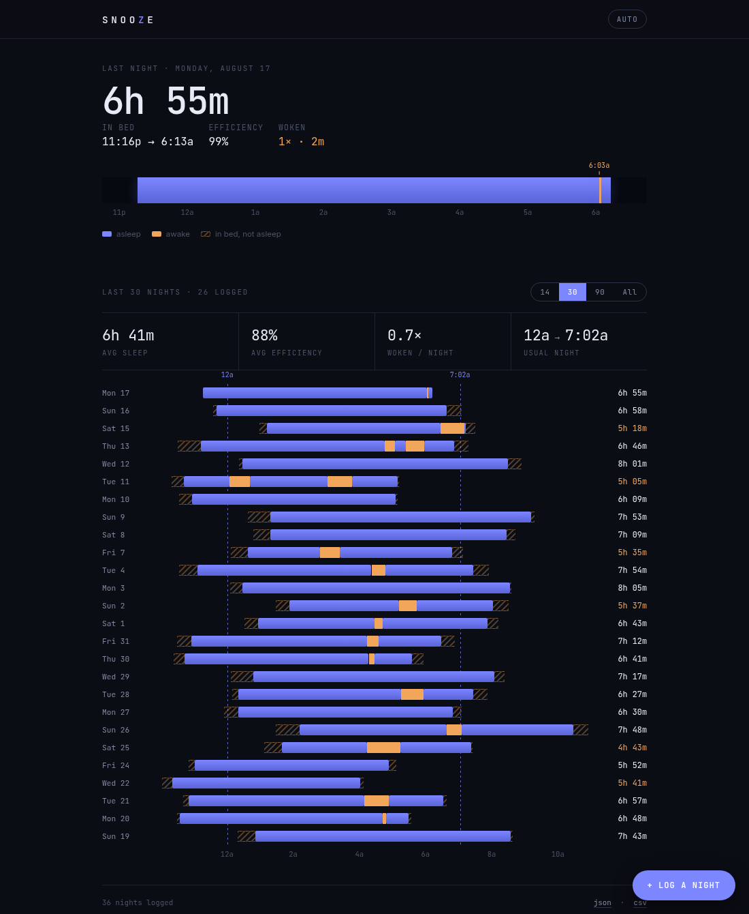
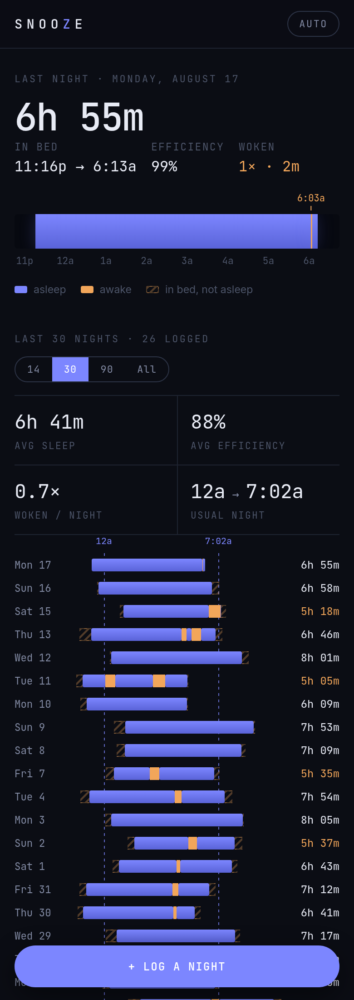

# SNOOZE

Self-hosted single-user sleep tracker. One entry a morning: when you got in bed,
when you woke, and what got you up in between. No scores, no ratings — it
records what happened and draws it back to you.

Each night is a ribbon on a clock axis: solid where you slept, warm where you
were awake, hatched where you were in bed but not asleep. Stacked, the edges of
thirty of them are your schedule drifting.

One Node process, one HTML file, one JSON file. No build step, no framework, no
charting library, no account, no cloud, no third-party requests.

<p align="center">
  
</p>

## Running it

```bash
docker compose up -d          # http://localhost:8430
```

Or without Docker:

```bash
npm install && npm start      # serves on :8430, writes ./data/nights.json
```

| Variable | Default | What it does |
| --- | --- | --- |
| `PORT` | `8430` | Port to listen on |
| `DATA_DIR` | `./data` | Where `nights.json` lives |
| `MAX_NIGHTS` | `50000` | Ceiling on stored nights, so a stuck client can't fill the disk |

There is no login. Put it on a LAN or a VPN, not on the open internet.

## Logging a night

Fill it in when you wake up. The only required fields are the date, the time you
got in bed, and the time you woke — everything else is optional and the numbers
still work without it. The date opens on today and steps a day at a time.

You are never asked for anything you can't know. The time you fell asleep isn't
one of those things, so the sheet asks roughly how long you took to drop off
instead, the way a paper sleep diary does; that gets added to your bedtime and
stored as a moment. Interruption lengths are estimates too, and are treated as
such.

A night is filed under **the morning you woke up**, and the times you type are
plain clock times. Bedtime lands on the evening before if it reads as an evening
(12:00 or later), and every other time is the first occurrence of that clock
time after bedtime. So a night logged under Saturday the 15th with "in bed
23:10, woke 06:45" runs from Friday evening to Saturday morning, and one with
"in bed 01:30, woke 09:00" runs from Saturday's small hours to Saturday morning.
The line under the times shows the night it all resolved to, so you can catch a
wrong day before saving rather than a month later in the stack.

One night per morning. Trying to save a second one for a date you've already
logged offers to open the existing night for editing instead.

Interruptions are typed from a half memory at 7am, so they're treated that way:
a length that runs past the moment you got up is clipped there, and two that
overlap count once. Neither can push a night's total below what it actually
held.

## What it works out for you

Nothing derived is stored — it's all computed from the times each time the page
loads, so a corrected formula corrects your whole history rather than only
future nights.

| | |
| --- | --- |
| Time in bed | in bed → out of bed |
| Time asleep | dropped off → woke, less every interruption |
| Efficiency | asleep ÷ time in bed — only an unbroken night reads 100% |
| Latency | how long you took to drop off |
| Awake | interruptions, clipped to the night and merged |

The page is one screen: last night as a full-width ribbon with its numbers, then
a range control governing everything below it — a strip of averages, and every
night stacked on a shared clock axis with your median bedtime and wake time
drawn down the middle as guide lines. Switch between 14, 30, 90 and all nights
and the averages, the medians, the guide lines and the axis all move with it. A
night an hour shorter than your own median is marked. Tapping any row opens it
for editing.

It is built for a phone first — that's where you are when you log a night — and
it follows your system's light or dark setting unless you pick one with the
toggle.

<p align="center">
  
</p>

## Your data

`data/nights.json` is a plain JSON array you can read, edit, back up or throw
away. `GET /api/export` gives you the whole thing; `GET /api/export/csv` gives
you a spreadsheet with the derived numbers already worked out.

## API

| | |
| --- | --- |
| `GET /api/nights` | Every night, newest first |
| `POST /api/nights` | Create — 409 if that date is already logged |
| `PUT /api/nights/:id` | Update |
| `DELETE /api/nights/:id` | Delete |
| `GET /api/export` | All nights as JSON |
| `GET /api/export/csv` | All nights as CSV, with derived columns |
| `GET /api/health` | `{"status":"ok","version":"…"}` |

## Versioning and releases

Every commit to `main` publishes `mrrthr/snooze:latest`, so `latest` runs ahead
of the newest tag. Cutting a release is a deliberate, separate act: a
bookkeeping commit that renames `## Unreleased` in the changelog to the version,
bumps `version` in `package.json` and `package-lock.json`, then a `v*.*.*` tag.
The tag publishes the numbered `1.2.3` / `1.2` / `1` images, and CI refuses a
tag that disagrees with `package.json`.

## Licence

MIT. The webfonts are vendored under `public/vendor/` with their own licences.
